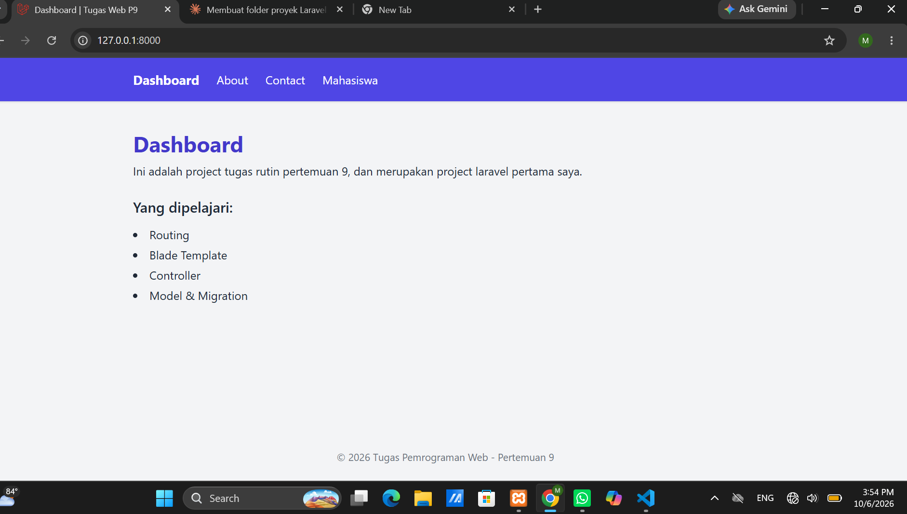
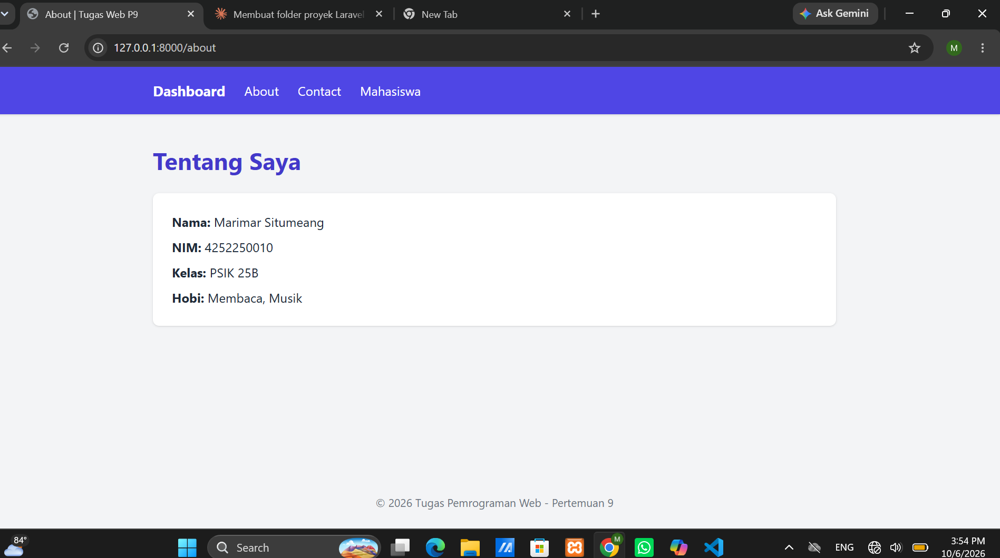
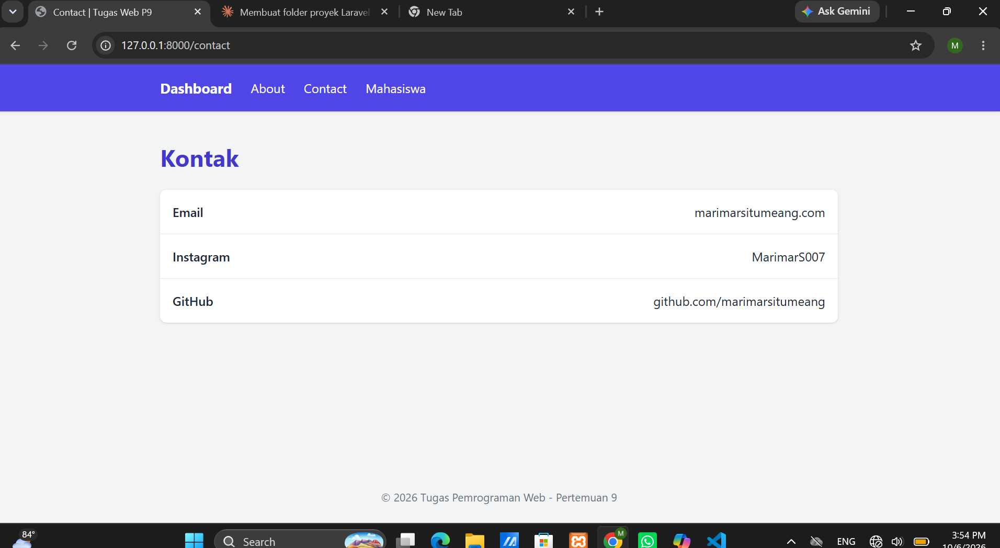
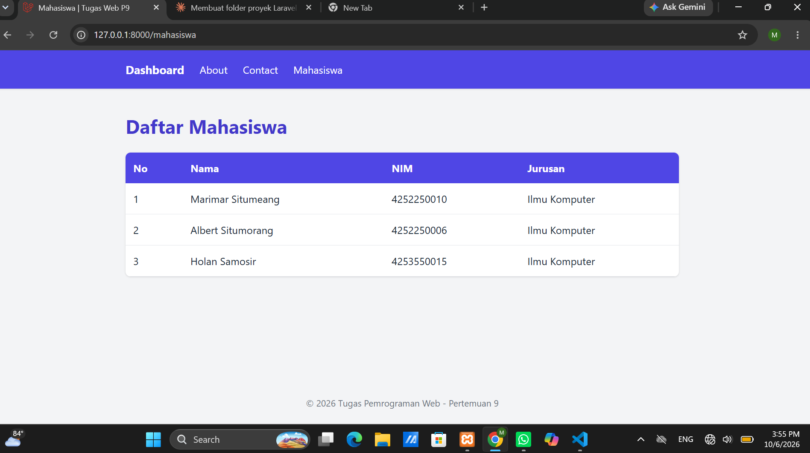
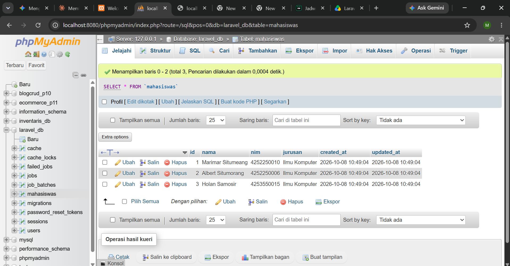

# TugasWeb-P9-LaravelSetup

| **Nama** | Marimar Situmeang
| **NIM** | 4252250010
| **Kelas** | PSIK 25B

## Teknologi Yang Diperlukan
- Laravel 12
- PHP 8.2 atau lebih baru
- MySQL (XAMPP) dan phpMyAdmin
- Composer
- Tailwind CSS via CDN (bonus)

## Kebutuhan Sistem
- XAMPP (Apache dan MySQL)
- Composer
- Git
- Koneksi internet (untuk Composer dan Tailwind CDN)

## Langkah Instalasi
### 2. Install dependency
```bash
composer install
```

### 3. Salin file environment dan buat app key
```bash
copy .env.example .env
php artisan key:generate
```

### 4. Buat database di phpMyAdmin
1. Jalankan **Apache** dan **MySQL** di XAMPP Control Panel.
2. Buka `http://localhost/phpmyadmin`.
3. Klik **New**, isi nama `tugasweb_p9`, pilih collation `utf8mb4_unicode_ci`, lalu klik **Create**.

### 5. Atur koneksi database di `.env`
```env
DB_CONNECTION=mysql
DB_HOST=127.0.0.1
DB_PORT=3306
DB_DATABASE=tugasweb_p9
DB_USERNAME=root
DB_PASSWORD=
```

### 6. Jalankan migrasi
```bash
php artisan migrate
```

### 7. Jalankan server
```bash
php artisan serve
```
Buka `http://127.0.0.1:8000` di browser.

> **Cara membuat project dari nol** (seperti yang dilakukan pada tugas ini):
> ```bash
> cd C:\xampp\htdocs
> composer create-project laravel/laravel TugasWeb-P9-LaravelSetup
> ```

## Daftar Route

| URL | Tampilan | Keterangan | Sumber |
|---|---|---|---|
| `/` | Dashboard | Halaman beranda dengan statistik dan data array | `routes/web.php` |
| `/about` | About | Profil mahasiswa (data array) | `routes/web.php` |
| `/contact` | Kontak | Daftar kontak (data array) | `routes/web.php` |
| `/mahasiswa` | Mahasiswa | Tabel daftar mahasiswa | `MahasiswaController@index` |
| `/hello/{nama}` | Hello | Bonus: route parameter | `routes/web.php` |
| `/welcome` | Welcome | Halaman bawaan Laravel (untuk screenshot) | `routes/web.php` |

## Struktur Folder

### Folder dan file yang dikerjakan pada tugas ini

| Lokasi | Fungsi |
|---|---|
| `routes/web.php` | Mendefinisikan route `/`, `/about`, `/contact`, `/mahasiswa`, `/hello/{nama}` dan data array yang dikirim ke view |
| `resources/views/layout.blade.php` | Layout utama (sidebar, menu, footer) yang dipakai semua halaman lewat `@extends` dan `@yield` |
| `resources/views/home.blade.php` | Tampilan Dashboard |
| `resources/views/about.blade.php` | Tampilan halaman About |
| `resources/views/contact.blade.php` | Tampilan halaman Kontak |
| `resources/views/hello.blade.php` | Tampilan route parameter |
| `resources/views/mahasiswa.blade.php` | Tampilan tabel mahasiswa |
| `app/Http/Controllers/MahasiswaController.php` | Controller (dibuat dengan `php artisan make:controller`) |
| `app/Models/Mahasiswa.php` | Model Eloquent (dibuat dengan `php artisan make:model Mahasiswa -m`) |
| `database/migrations/..._create_mahasiswas_table.php` | Skema tabel `mahasiswas` |
| `.env` | Konfigurasi lingkungan: koneksi database, app key (tidak di-upload ke GitHub) |

### Struktur bawaan Laravel

| `app/` | Kode utama aplikasi: Controllers, Models, Providers |
| `bootstrap/` | File untuk proses booting framework dan cache |
| `config/` | File konfigurasi aplikasi (database, session, cache, dll.) |
| `database/` | Migrations, seeders, dan factories |
| `public/` | Entry point (`index.php`) dan aset publik (CSS, JS, gambar) |
| `resources/` | View Blade, CSS, dan JavaScript mentah |
| `routes/` | Definisi route (`web.php` untuk halaman web) |
| `storage/` | Log, cache, dan file yang dihasilkan aplikasi |
| `tests/` | File pengujian |
| `vendor/` | Library hasil instalasi Composer (tidak di-upload ke GitHub) |
| `artisan` | CLI Laravel untuk menjalankan perintah (`serve`, `migrate`, `make:*`) |
| `composer.json` | Daftar dependency PHP project |

## Perintah Artisan yang Digunakan
```bash
php artisan serve                       # menjalankan server lokal
php artisan make:controller MahasiswaController   # membuat controller
php artisan make:model Mahasiswa -m     # membuat model + migration
php artisan migrate                     # menjalankan migrasi
```

## Pemenuhan Syarat Tugas


| 1 | Install Composer dan buat project (`composer create-project`) | Langkah instalasi di atas |
| 2 | Buat DB di phpMyAdmin dan konfigurasi `.env` (MySQL) | Langkah 4 dan 5, screenshot phpMyAdmin |
| 3 | `artisan serve` berjalan dan screenshot welcome page | Screenshot Welcome Page |
| 4 | 3 route custom (`/`, `/about`, `/contact`) mengembalikan Blade view | `routes/web.php`, screenshot ketiga halaman |
| 5 | View menampilkan data dinamis (array dari route) | `@foreach` dan `{{ }}` di view |
| 6 | Memakai `make:controller` dan `make:model -m` minimal 1x | `MahasiswaController`, model `Mahasiswa` + migration |
| 7 | README: langkah install dan penjelasan struktur folder | File ini |
| 8 | Repo bernama `TugasWeb-P9-LaravelSetup` | Link repository |
| Bonus | Tailwind CDN dan route parameter `/hello/{nama}` | `layout.blade.php`, route `/hello/{nama}` |

## Screenshot

### Welcome Page (halaman bawaan Laravel)

### Dashboard (`/`)


### About (`/about`)


### Kontak (`/contact`)


### Daftar Mahasiswa (`/mahasiswa`)


### Database di phpMyAdmin

